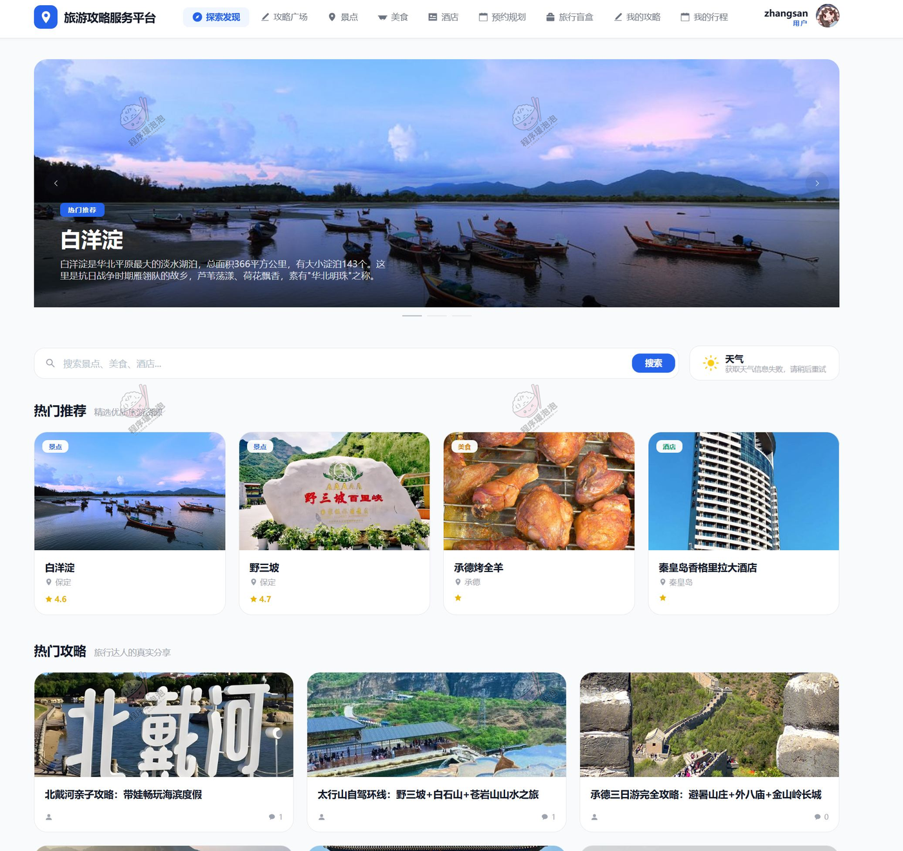
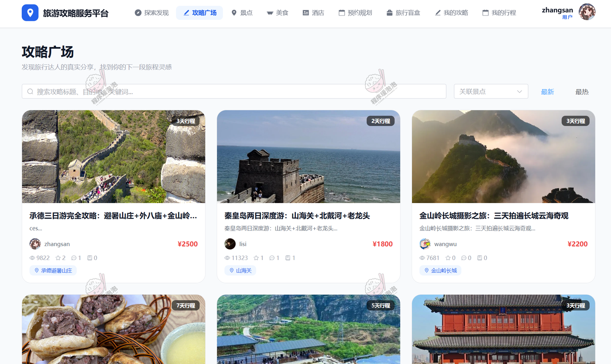
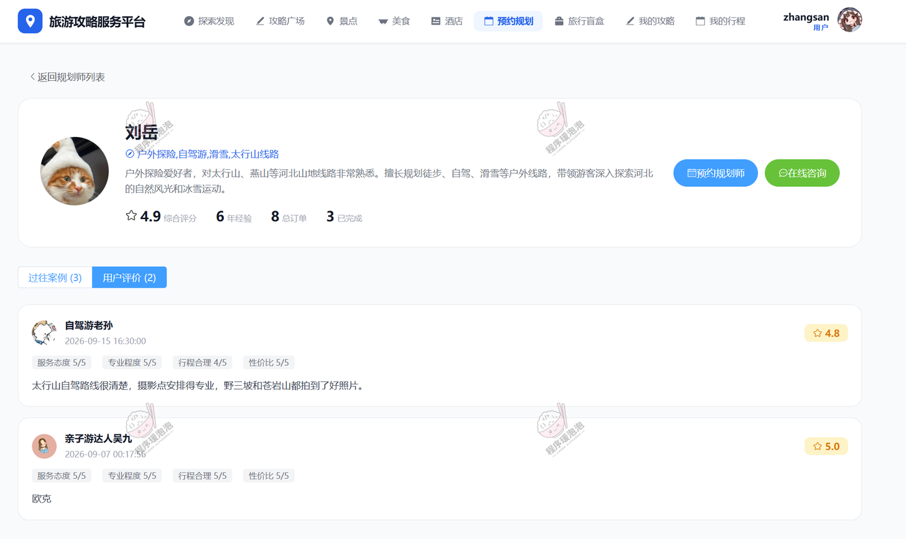
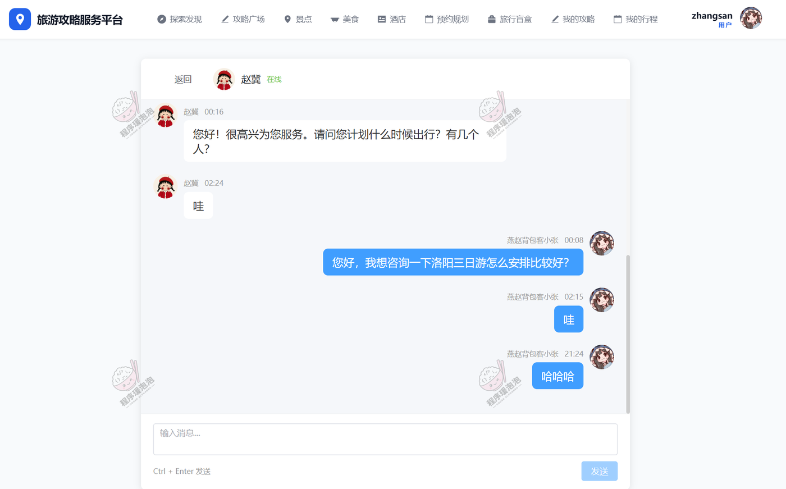
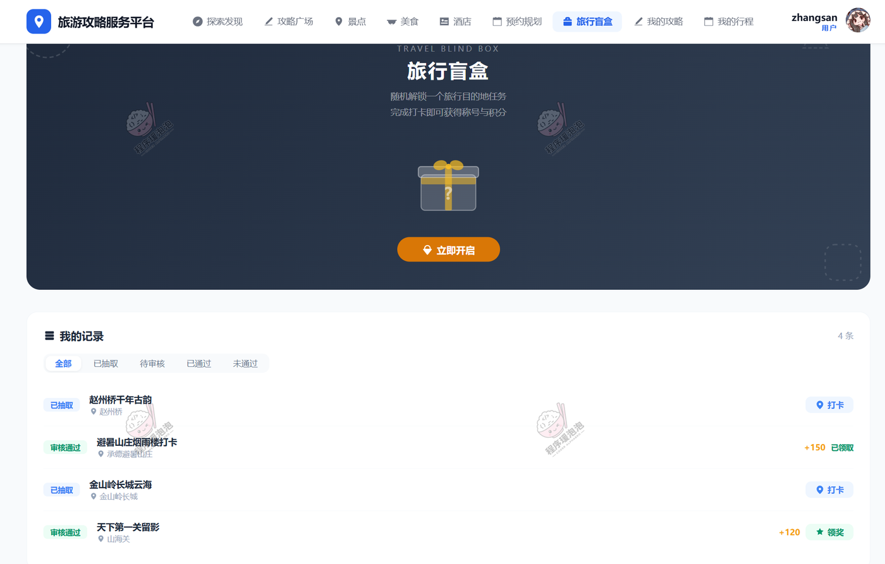
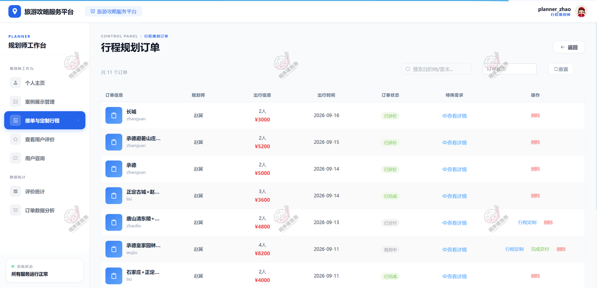
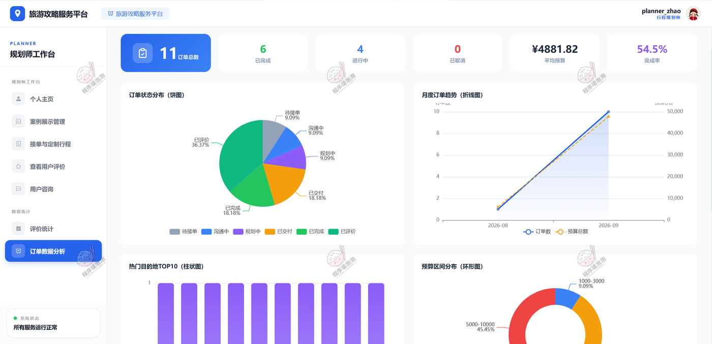
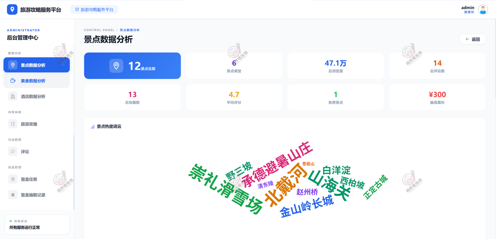
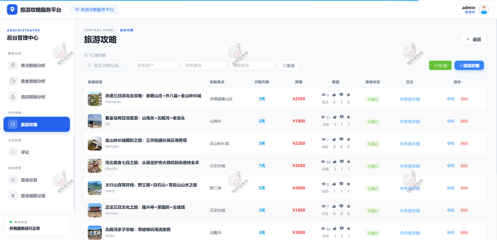
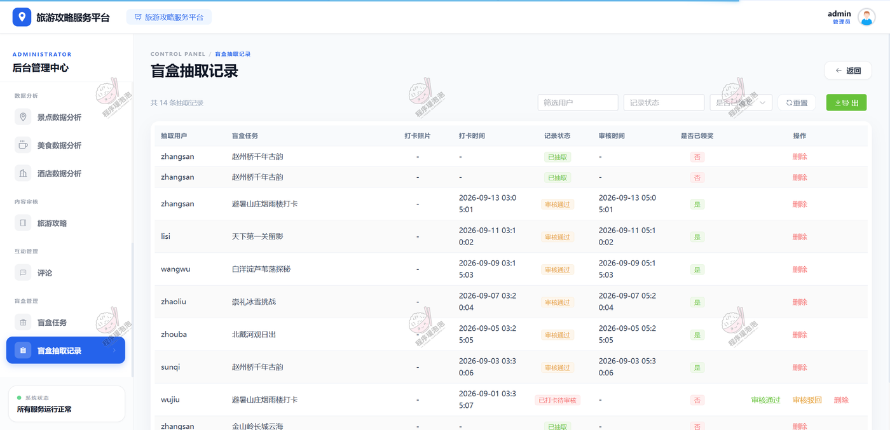

# TravelGuideServicePlatform
旅游攻略服务平台
亮点：WebSocket在线咨询，协同过滤推荐，天气接口、ECharts数据分析、旅游攻略发布审核与评论点赞收藏，行程规划师预约、方案交付和服务评价，旅行盲盒打卡积分；
角色：用户、行程规划师、管理员；
数据库：28张；

所有源码均本人开发，项目是前后端分离的，所有的项目都具备了完整的业务逻辑，不仅仅局限于基础的增删改查（CRUD）操作，系统亮点众多。

本文注重于计算机毕业设计选题指导，列出题目均有源码， 大家可以去【公众号】(毕业终点站)获取或者加我【qq】(2112698948)提意见(别忘记Star哟)。备注：git

声明：仅用于学习使用，请勿用于任何商业行为！

1.系统非商用，非开源，非无偿。

2.由本人开发，如需源码，请联系以下方式，qq:2112698948。

3.项目有很多，并未全部上传，如果未找到想要的，可直接咨询。

# 旅游攻略服务平台

> 基于 Spring Boot 3 + Vue 3 的前后端分离旅游攻略平台，普通用户 / 行程规划师 / 管理员三角色协同。
> 集成 WebSocket 在线咨询、协同过滤推荐、Coze 城市天气接口、ECharts 数据分析、攻略发布审核与评论点赞收藏、行程规划师预约与方案交付、旅行盲盒打卡积分。

## 一、项目简介

这是一套围绕"旅行"搭建的 Web 平台。用户看攻略、逛景点美食酒店、约规划师做定制行程、抽盲盒打卡攒积分；规划师接单、按天设计行程并交付方案；管理员维护资源、审核攻略与打卡记录、查看数据——三方围绕旅行服务这条主线协作。

系统里几个花心思的地方：

- **协同过滤推荐**：把收藏、点赞、评论分别按 3、2、1 加权，算用户间余弦相似度，按相似用户兴趣推荐景点、美食、酒店和攻略；新用户或推荐不足时用热门内容补充。
- **WebSocket 在线咨询**：用户与规划师实时沟通出行偏好和方案细节，支持会话和历史消息查看，方便持续跟进行程需求。
- **定制行程服务**：用户填目的地、人数、预算和特殊需求，规划师按天安排方案，串联需求提交、方案设计、订单交付和服务评价。
- **旅行盲盒打卡**：随机抽旅游任务，上传打卡后进入审核，审核通过发放积分奖励，把旅游探索和互动激励结合。
- **Coze 城市天气**：根据用户资料中的城市获取天气，并用数据库缓存保存一小时，减少重复调用。
- **攻略分享与审核**：用户发布旅游经验，管理员审核内容，配合评论、点赞和收藏，让攻略持续积累、方便再次查阅。
- **多维数据可视化**：用 ECharts 展示景点、美食、酒店、订单和评价统计，辅助管理员与规划师了解资源和服务情况。

## 二、技术栈

| 分层 | 技术 |
|---|---|
| 架构 | B/S、MVC、前后端分离，普通用户 + 行程规划师 + 管理员多角色管理 |
| 后端 | Java、Spring Boot 3、Spring MVC、MyBatis-Plus、JWT、WebSocket、Spring AOP、Apache POI、HttpClient、Coze API |
| 前端 | Vue 3、Vite、Element Plus、Vue Router、Pinia、Axios、ECharts |
| 推荐算法 | 基于用户的协同过滤、余弦相似度、用户行为加权评分、热门推荐补充 |
| 环境 | Windows / IDEA / JDK 17 / Maven / MySQL / Node.js |

## 三、系统功能

### 3.1 用户端
- 注册登录、忘记密码、个人资料与密码维护
- 首页热门与个性化推荐、所在城市天气查看、全站搜索
- 景点、美食、酒店分类浏览与详情查看
- 攻略浏览、攻略发布、我的攻略、评论、点赞、收藏
- 规划师浏览、案例查看、行程规划预约、出行需求提交
- 我的行程订单、行程方案查看、行程沟通、服务评价
- 在线聊天、会话记录查看
- 随机抽取盲盒任务、上传打卡、查看审核状态、旅游积分查看

### 3.2 行程规划师端
- 个人资料与规划师资料维护、擅长领域与从业信息维护
- 规划师案例展示、客户咨询查看、在线聊天回复
- 行程订单查看、按天设计行程、方案明细维护、方案交付
- 服务评价查看、订单统计、评价统计、密码修改

### 3.3 管理员端
- 控制台概览、用户管理、个人资料与密码维护
- 景点类型与景点信息、美食类型与美食信息、酒店信息管理
- 攻略标签与旅游攻略管理审核、评论管理、点赞与收藏管理
- 行程规划师管理、案例管理、行程订单与方案维护、服务评价管理
- 盲盒任务管理、打卡记录审核、聊天会话与消息管理、天气缓存管理
- 景点 / 美食 / 酒店 / 订单 / 评价统计、数据导出

## 四、系统截图

以下选取 10 张代表性截图，按三个角色分别展示。源文档首图为登录入口页，未提供独立的系统总览图。

### 4.1 用户端

**首页** —— 顶部搜索条与天气小组件，中部是轮播推荐和景点 / 美食 / 酒店热门卡片，下方是热门攻略；热门内容来自协同过滤推荐，新用户则由热门内容补充。

**攻略广场** —— 按标题和关联景点搜索，支持最新 / 最热排序，攻略卡片展示标题、行程天数、作者、预算和浏览、点赞、评论、收藏数据，是攻略分享与互动的入口。

**预约规划师** —— 查看规划师的擅长领域、综合评分、经验与完成订单数，可查看过往案例和用户评价，并直接"已预约规划师"或发起"在线咨询"。

**在线咨询** —— 用户与规划师的实时聊天窗口，围绕出行时间、人数和线路安排沟通，对应 WebSocket 消息收发与历史会话查看。

**旅行盲盒** —— 盲盒抽卡入口与"我的记录"，记录按已抽取 / 待审核 / 已通过 / 未通过分类，打卡通过后发放积分奖励。

### 4.2 行程规划师端

**接单与定制行程** —— 行程规划订单列表展示目的地、人数、预算、出行时间和特殊需求，支持查看详情、进入行程规划并完成交付。

**订单数据分析** —— 订单总数、已完成、进行中、平均价格和完成率概览，配合状态分布饼图、月度订单趋势、热门目的地 TOP10 和预算区间分布。

### 4.3 管理员端

**景点数据分析** —— 景点总数、类型数、总浏览量、总评论数、总收藏数和平均评分概览，配合景点热度词云，是多维数据可视化的代表。

**旅游攻略** —— 按标题、发布用户、关联景点和审核状态筛选攻略，支持查看详情、审核、删除与导出，承担攻略发布审核的职责。

**盲盒抽取记录** —— 查看抽取用户、盲盒任务、打卡图片与时间、记录状态和积分领取情况，支持审核通过与驳回，配合积分规则维护打卡秩序。

---

文档展示 10 张截图，需要了解更多，请联系我。
